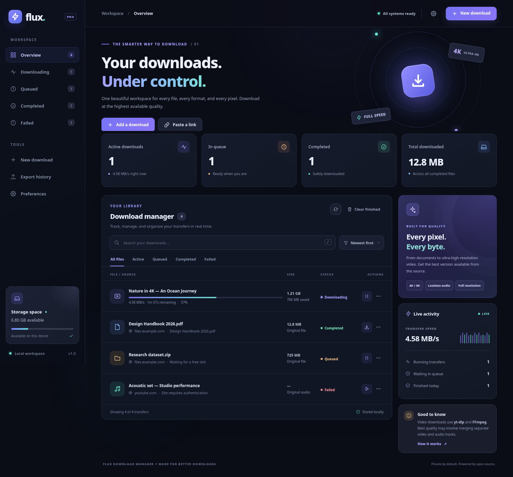
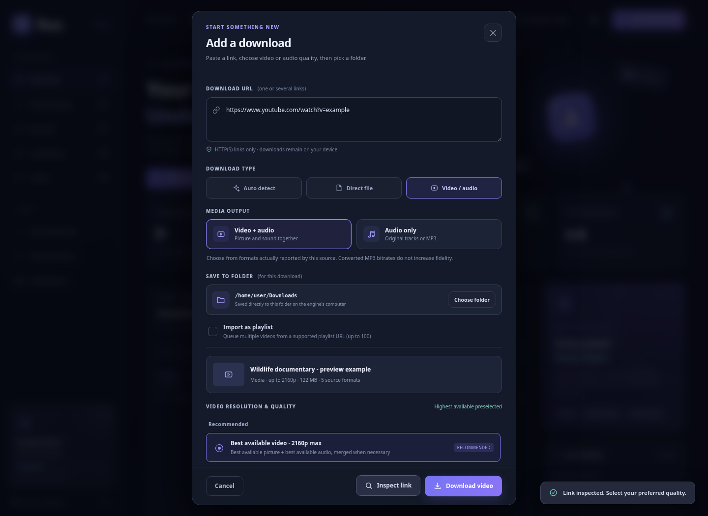
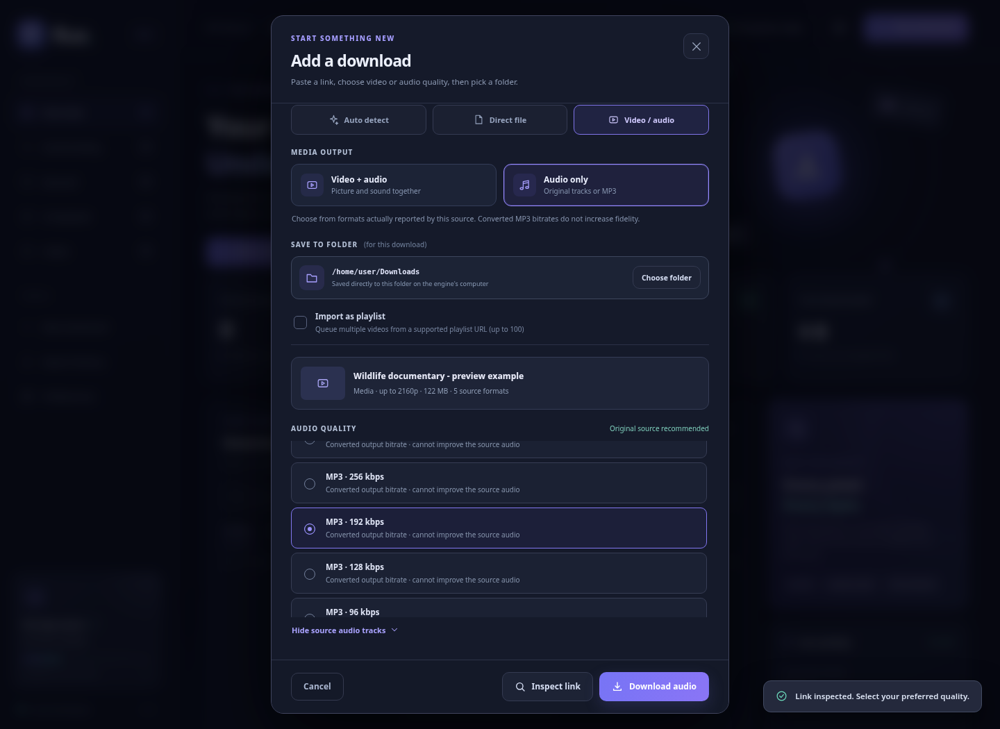
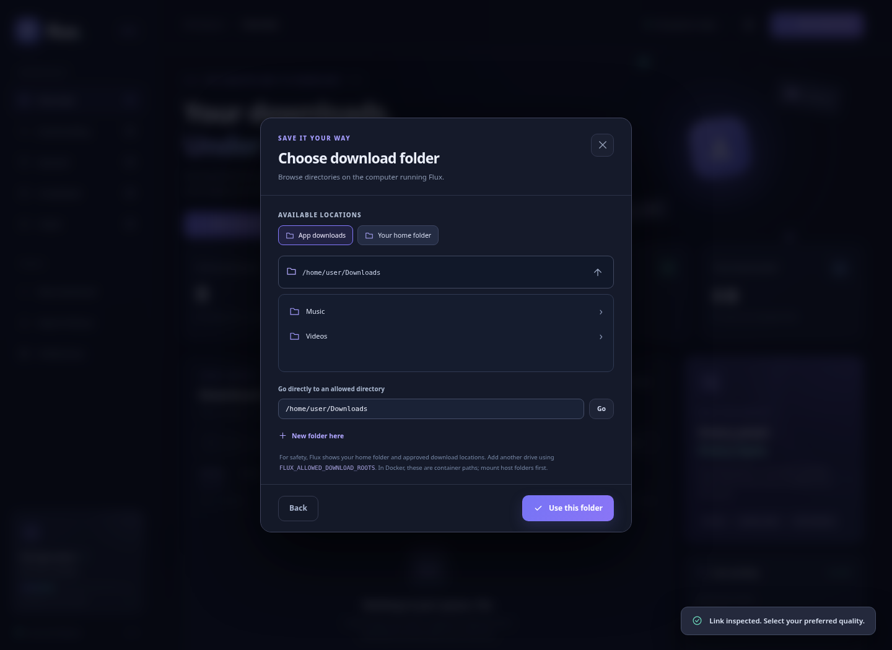

# Flux Download Manager — v1.1

**A full-stack, local-first internet download manager** built with Python, FastAPI, SQLite, yt-dlp, FFmpeg and a responsive HTML/CSS/JavaScript dashboard.



### New in v1.1

- **Choose the destination for every download**: use **Choose folder** to browse allowed folders on your computer or create a new folder. The destination is saved in each job so queue/resume/restart doesn't change it. You can also choose a new default folder in **Preferences**. Downloaded files are written straight into the selected folder, even when it is on another disk.
- **Video + audio / Audio only** is now an explicit selection. Switch between the two without losing your previous quality choice.
- **Separate, source-aware quality lists**: video resolutions and individual video tracks; original audio bitrates/tracks; MP3 VBR or 64/96/128/192/256/320 kbps conversions. Actual source bitrate entries are reported by yt-dlp — MP3 bitrate choices are conversion targets and **do not improve source fidelity**.







## What it can do

- Download direct HTTP and HTTPS files, including documents, installers, archives, audio and video files.
- **Download the highest available media quality** on sites supported by yt-dlp. The default format selector is `bv*+ba/b/ba`: best video (which may include audio) plus best audio, or a combined stream, falling back to the best original audio for audio-only sources. FFmpeg merges separate streams into a single output file, generally MKV for compatibility.
- Inspect a video URL to see **actual reported video resolutions**, individual tracks and codecs, and **source-reported audio bitrates and formats** in separate lists.
- Choose from the resolutions actually available at the source (for example 720p, 1080p, 4K, or 8K where supported), individual extractor-reported video streams, best original audio, individual original audio streams, or MP3 conversion targets.
- Detect audio-only sources and preselect **best original audio**, avoiding unnecessary conversion.
- Use **up to eight parallel HTTP connections** for files of 8 MiB or more when a server correctly supports byte ranges, or automatically fall back to single-stream transfers.
- **Pause and resume** compatible transfers, keep partial files, retry interrupted HTTP downloads and keep a persistent SQLite queue across restarts.
- Set the simultaneous transfer count, per-file HTTP connection count, per-download speed cap and retry count.
- Add multiple links at once, import supported playlists (up to 100 entries per operation), and prioritize downloads in the queue.
- Track speed, downloaded size, progress, and estimated time remaining; search and filter history; download finished files from the browser; export history to CSV.
- Choose a different **download folder per job**, or change a persistent **default save folder**. The app securely lists only allowlisted server directories, and can create subfolders. Cross-volume copies are finalized atomically.
- Run directly with Python or with Docker; no Node.js or JavaScript build step required.

### Important quality notes

**"Best available" means the best stream quality made available by the source**, not a guarantee of 4K/8K on every URL. A converted 320-kbps MP3 cannot recover fidelity that wasn't present in the source audio; select **Best audio · original format** to avoid that conversion. Sites may modify access methods over time. DRM-protected streams, login-restricted videos without authorized credentials, and unsupported websites are not bypassed.

## Quick start — Windows

1. Install **Python 3.10 or newer** (3.12 recommended) and ensure Python is on PATH. Install [FFmpeg](https://ffmpeg.org/download.html) and ensure `ffmpeg -version` works in Command Prompt. On Windows you can also try `winget install Gyan.FFmpeg` followed by a new terminal.
2. Extract this project and double-click **`start.bat`**.
3. When the server starts, open **http://127.0.0.1:8000** in your browser.

The first launch creates `.venv` and installs the Python packages. Package installation requires internet access. A console window must stay open while downloading.

## Quick start — Linux / macOS

Install Python, Python `venv` support, and FFmpeg. For Debian/Ubuntu:

```bash
sudo apt-get update
sudo apt-get install -y python3 python3-venv ffmpeg
```

From the project folder:

```bash
chmod +x start.sh
./start.sh
```

Open **http://127.0.0.1:8000**. For macOS, you can install FFmpeg with `brew install ffmpeg` if Homebrew is available.

### Manual startup

```bash
python3 -m venv .venv
source .venv/bin/activate           # On Windows: .venv\Scripts\activate
pip install -r requirements.txt
python -m app.main
```

Install the latest yt-dlp release when a supported website changes its behavior:

```bash
python -m pip install -U yt-dlp
```

## Docker

Docker packages Python, yt-dlp and FFmpeg in one reproducible container. Run:

```bash
docker compose up --build -d
```

Open **http://127.0.0.1:8000**. Local bind mounts keep `./data` (SQLite) and `./downloads` (completed and partial files) on the host. The container binds to localhost only. On certain systems with restrictive mount permissions you may need to make `./data` and `./downloads` writable for the container's `flux` user (UID 10001).

```bash
docker compose logs -f
docker compose down
```

## How to download

1. Open **New download** and paste one URL (or several for batch downloading).
2. Choose **Video / audio** when downloading supported media. Two clear choices will appear: **Video + audio** or **Audio only**. Choose **Inspect link** to fetch the actual formats offered for a single video/audio URL.
3. For **Video**, choose **Best available**, a source-reported resolution (such as 720p, 1080p, 2160p), or an individual video format. For **Audio only**, choose **Best original audio**, a source audio bitrate/format, or a converted MP3 target bitrate (64–320 kbps or best VBR).
4. Under **Save to folder**, choose **Choose folder**, navigate the folders on the computer running Flux, and select an existing folder or create a new one. This overrides the default for this job only.
5. Select **Download video**, **Download audio**, or **Start download**. Batch and playlist downloads will use the selected media quality and destination. Pause, resume, retry, cancel, reprioritize, or remove jobs from the queue as before.
6. To use the same destination for future jobs, open **Preferences → Download location → Change folder → Save preferences**.

The original file is written to the selected destination on the **server computer**. The download icon in the completed row still lets you save a separate copy through the browser. For supported playlist URLs, enable **Import as playlist**.

**Keyboard:** `Ctrl/⌘ + K` creates a download, `/` focuses search, and `Esc` closes dialogs.

## Where files live

```text
flux-download-manager/
├── app/                FastAPI endpoints, queue, workers, folders, media extractors
├── static/             Responsive dashboard — no build step
├── tests/              Offline end-to-end tests
├── preview/            Dashboard screenshots
├── data/               SQLite database (created at runtime)
├── downloads/          Original app download folder + temporary transfers
│   └── .parts/         Partial files and temporary media segments
├── (chosen folders)    Completed files in per-job or default destination
├── requirements.txt
├── start.bat / start.sh
├── Dockerfile
└── docker-compose.yml
```

A downloaded file is stored on the **machine running the Python/Docker server**, in the specific folder you selected for that job. Browser access from another computer does not grant the Python server access to that browser computer's private directories. Transferring a completed file through the UI saves a browser-side copy. The internal `.parts` directory stays within `FLUX_DOWNLOAD_DIR` to support resuming.

### Choosing a folder on Windows, Linux or macOS

The **Choose folder** dialog browses the backend computer's directories. Out of the box, it includes your **home folder** (usually containing Desktop, Downloads, Videos and Music) and Flux's original download directory. You can browse existing subfolders, create a new folder, or enter an absolute path **inside one of these allowed locations**.

For another drive or external disk, add it as an approved root before launching the server:

Windows Command Prompt (example):

```bat
set FLUX_ALLOWED_DOWNLOAD_ROOTS=D:\Media;E:\Downloads
start.bat
```

Linux/macOS (example):

```bash
FLUX_ALLOWED_DOWNLOAD_ROOTS=/mnt/external:/media/backup ./start.sh
```

The path separator is `;` on Windows and `:` on Linux/macOS. Directories must already exist and the server account needs write permission. **For Docker**, mount each extra host folder into the container first, then set `FLUX_ALLOWED_DOWNLOAD_ROOTS` to the **container path**, not the host path. For example, mount `./my-media:/media` and allowlist `/media`. These restrictions prevent the web API from writing arbitrary system files.

## Configuration

In the dashboard, open **Preferences** to change the options below. Defaults:

| Setting | Default | Limits / meaning |
|---|---:|---|
| Simultaneous downloads | 3 | 1–6 concurrently running jobs |
| Connections per direct file | 4 | 1–8; used for byte-range-capable files ≥ 8 MiB |
| Per-download speed limit | 0 KB/s | 0 = unlimited; applies to direct file and yt-dlp jobs |
| Automatic HTTP retries | 3 | 0–8 retries |
| Default save directory | Original `downloads/` directory | Change with the folder browser; saved in SQLite |

Environment variables:

| Name | Default | Purpose |
|---|---|---|
| `FLUX_HOST` | `127.0.0.1` | API bind address (Docker uses `0.0.0.0` inside a localhost-published container) |
| `FLUX_PORT` | `8000` | HTTP port |
| `FLUX_DATA_DIR` | `./data` | SQLite storage location |
| `FLUX_DOWNLOAD_DIR` | `./downloads` | Original destination and temporary transfer files; can be overridden per job or by stored preference |
| `FLUX_ALLOWED_DOWNLOAD_ROOTS` | unset | Additional allowed directory roots for destination browsing; OS path-separated list |
| `FLUX_ALLOW_PRIVATE_HOSTS` | `0` | Allow downloads from LAN/private URLs (**unsafe on untrusted networks**) |

If you need another port, use e.g. `FLUX_PORT=9000 python -m app.main` on Linux/macOS. On Windows Command Prompt: `set FLUX_PORT=9000` then `python -m app.main`.

### Security and operating constraints

- This is a **single-user localhost application** with **no login layer**. Do not expose it directly to the public internet. If you need remote access, add authentication, HTTPS and a deployment security review first.
- Initial and redirect URLs are checked and local/private/reserved IP addresses are blocked by default to reduce misuse. This is not a substitute for a hardened deployment sandbox, particularly for arbitrary third-party media extractors or DNS rebinding attacks.
- Files are not automatically renamed to executable-safe formats; treat downloaded files as untrusted until scanned by your normal security tools.
- Resuming depends on the remote HTTP server supporting compatible byte-range requests. Multi-connection downloading activates only after range support is verified.
- Video extraction and playlist import require a working **yt-dlp** install. Separate high-quality streams, MP3 conversion and many video formats require **FFmpeg**.
- Limit to one Python web-server process / worker because this edition has an in-process scheduler. Running multiple `uvicorn --workers` would cause competing schedulers.
- Large downloads may temporarily require extra free space for segmented pieces and the final assembled file. Cross-drive destinations may require extra space during a temporary copy. DRM-protected content and websites that reject automated transfers are not supported. Download only files and media you have permission to access.

## API

FastAPI automatically documents the REST API at **http://127.0.0.1:8000/docs**.

| Endpoint | Action |
|---|---|
| `POST /api/probe` | Analyze a file/media URL; discover available source quality |
| `GET /api/jobs` | List queue/history |
| `POST /api/jobs` | Add one download; accepts `save_dir` and `quality` |
| `POST /api/jobs/batch` | Add up to 40 URLs; accepts `save_dir` and `quality` |
| `POST /api/playlists/import` | Import up to 100 media entries; accepts `save_dir` and `quality` |
| `POST /api/jobs/{id}/pause` | Pause |
| `POST /api/jobs/{id}/resume` | Resume/retry |
| `POST /api/jobs/{id}/cancel` | Cancel |
| `PATCH /api/jobs/{id}/priority` | Set priority |
| `GET /api/jobs/{id}/file` | Stream the completed file to browser |
| `DELETE /api/jobs/{id}` | Remove history entry (optional file deletion) |
| `DELETE /api/completed` | Clear completed history |
| `GET /api/export` | CSV export |
| `GET /api/config`, `PATCH /api/config` | Engine configuration; accepts `default_save_dir` |
| `GET /api/folders?path=...` | List allowed directory children and roots |
| `POST /api/folders` | Create a subfolder beneath an approved directory |
| `POST /api/folders/validate` | Confirm a destination exists and is writable |
| `GET /api/health` | Capability and runtime status |

**Example: create a highest-available-quality video download**

```bash
curl -X POST http://127.0.0.1:8000/api/jobs \
  -H 'Content-Type: application/json' \
  -d '{"url":"https://example.org/supported-video","kind":"media","quality":"best","save_dir":null}'
```

The placeholder URL above is illustrative; substitute a real supported URL.

## Tests

The tests use a local HTTP server with real range requests, and mock the media extractor where network access is unavailable:

```bash
pip install -r requirements-dev.txt
python -m pytest -q
```

End-to-end checks include HTTP download integrity, pause/resume, batch queue operations, segmented downloads, default/custom folders, folder validation, cross-device relocation, video/audio quality lists, MP3 target bitrates, database restart recovery, and the media worker workflow. **22 automated offline tests pass. Live external-site media downloading is not exercised by the offline test suite.** The separate browser QA uses simulated extractor metadata and locally mocked API responses for interaction testing.

## Tech stack

- **API and jobs:** Python 3.10+, FastAPI, Pydantic, Uvicorn, background thread pool
- **Persistence:** SQLite with WAL
- **Direct files:** Requests, HTTP Range and streaming writes; up to 8 connections
- **Media:** yt-dlp, FFmpeg
- **Dashboard:** HTML5, responsive CSS, plain JavaScript, inline SVGs
- **Deployment:** Python virtual environments or Docker Compose

License: MIT.
